# Mubashar Sharif

**Senior SEO Analyst · Founder, SEO Autopilot**
Daska, Punjab, Pakistan · Works US business hours

I'm Mubashar Sharif, a Senior SEO Analyst and the founder of SEO Autopilot, with 5+ years of hands-on technical, local and ecommerce SEO for 20+ clients. I helped a 35,000-product store grow monthly net sales from $5,832 to $19,100 in two months, took a Michigan retailer from about 4,000 to 12.2K indexed pages, and ranked a UK remittance brand #1 above Wise and Xoom, with 113K organic clicks in 2024. I also built SEO Autopilot, the content and indexing system used in that Michigan recovery. I'm Semrush and HubSpot certified.

[Email me](mailto:mubasharshahzad726@gmail.com) · [LinkedIn](https://www.linkedin.com/in/mubashar-sharif-senior-seo-analyst)

| 5+ | 20+ | +227% |
|---|---|---|
| years of hands-on SEO | clients served | monthly net sales, SMK Store |
| **12.2K** | **113K** | **46,000+** |
| pages indexed, Michigan Outdoor Sports | organic clicks in 2024, Remit Choice | product pages, programmatic SEO |

## SEO Autopilot: founder and builder

SEO Autopilot is the system I built to fix thin product and brand pages across a whole catalog. It checks each product first, so a page with no photo, no price or nothing to buy is skipped. It then writes unique copy with AI, scores it, publishes to WordPress, and submits the URL for indexing, under a daily publishing cap.

**Used on Michigan Outdoor Sports, where indexed pages grew from about 4,000 to 12.2K by 21 August 2026.**

Built with: Next.js, Gemini API, PostgreSQL, WordPress, Google Search Console

## Case studies

Each result is backed by original screenshots from Google Search Console, WooCommerce, Business Profile or a live Google search.

### SMK Store

*Ecommerce SEO · United States · April to June 2026*

**Monthly net sales from $5,832 to $19,100 in two months (+227%).**

- **Problem:** A 35,000-product catalog with thin, near-identical descriptions, poor indexing and failing Core Web Vitals.
- **What I did:** Rewrote product content brand by brand, improved crawl budget, added product schema, fixed Core Web Vitals and resubmitted pages in batches.

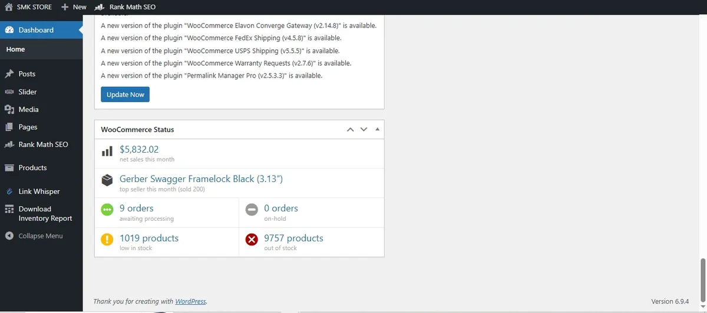  

### Michigan Outdoor Sports

*Technical SEO · Michigan, USA · May to September 2026*

**Indexed pages from about 4,000 to 12.2K, and US clicks from 224 to 322.**

- **Problem:** Thin brand and product pages, mass non-indexing and wasted crawl budget after a de-indexing event.
- **What I did:** Submitted sitemaps, fixed indexing blocks and crawl waste, and rewrote thin pages at scale with SEO Autopilot. Net sales went from $0.00 on 20 July to $523.49 month to date on 25 September.

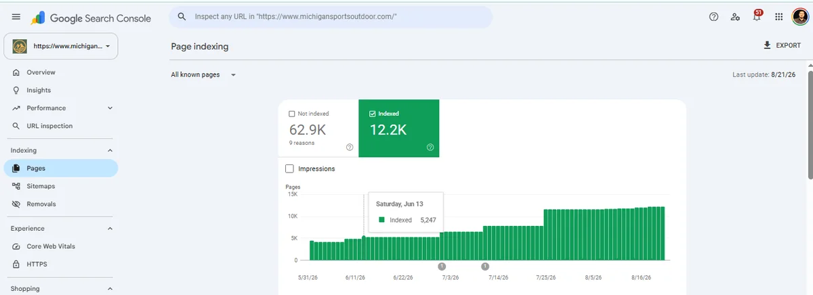 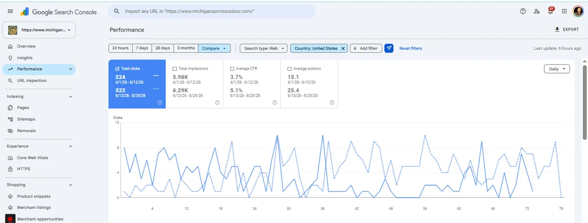 

### Remit Choice

*International SEO · UK and global · From 2023, in-house*

**#1 above Wise and Xoom, named in an AI Overview, and 113K organic clicks in 2024.**

- **Problem:** Duplicate country and corridor pages, thin content, no heading structure and no keyword mapping.
- **What I did:** Introduced international SEO: one page per country and corridor, one primary search per page, consolidated copy and a clear heading structure.

 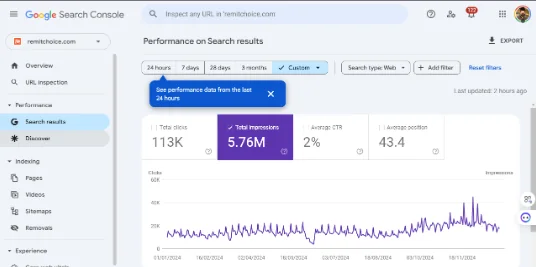 

### HVAC Services Team

*Local SEO and AI search · Simi Valley, CA*

**Named in Google's AI Overview, with the blog on page one for local AC searches.**

- **Problem:** A local company whose service and blog pages were missing from the AC searches customers make before they call.
- **What I did:** Cleaned up technical issues, rebuilt core service pages, strengthened local signals and structured content for AI Overviews.

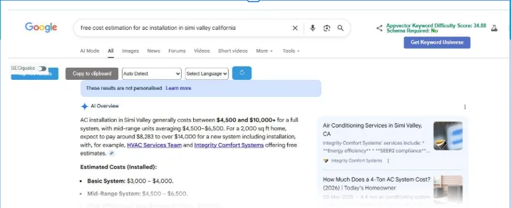 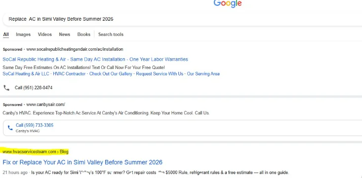 

### D.O.L.L.S. Cleaning

*Local SEO · Michigan, USA · June to July 2025*

**Impressions from 41K to 106K in a month, plus #1 and #2 for Clawson carpet cleaning.**

- **Problem:** An underused Google Business Profile and no service-area pages, so directories took the local searches.
- **What I did:** Optimized the Business Profile, built service-area pages, fixed local on-page signals and citations, and set up a steady review process.

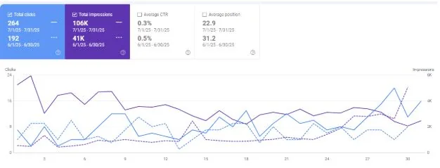 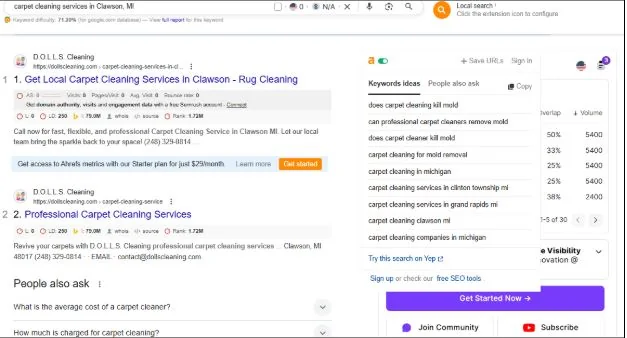 

### Mammoth Roofing

*Local SEO · Texas · 28 days to October 2024*

**Impressions from 16.9K to 45.2K in 28 days (+167%).**

- **Problem:** Stuck beyond page one for revenue keywords, with thin service pages and weak local signals.
- **What I did:** Mapped keywords across services, built location pages, fixed technical issues and published content around what Texas homeowners search.

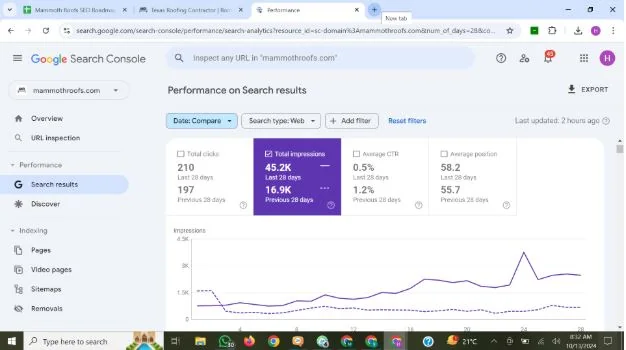 

### Door Doctor

*Google Business Profile · Multiple locations · April to May 2025*

**490 Business Profile interactions in two months.**

- **Problem:** Inconsistent profiles across locations, with mismatched details and no posting routine.
- **What I did:** Standardized business details across every location, optimized each profile and set up a posting and review routine.

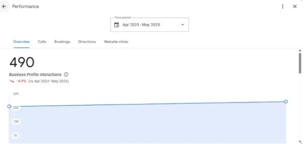 

### Glendora Kitchen Cabinets

*Local SEO · Glendora, CA*

**Position 5 on Google for "kitchen cabinet replacement in Glendora".**

- **Problem:** No rankings for remodel and cabinet searches, and a business relying on referrals.
- **What I did:** Researched high-intent local terms, rebuilt on-page SEO and created content for Glendora and nearby cities.

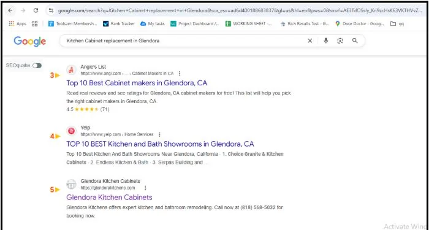 

## Certificates

- [SEO Fundamentals](https://static.semrush.com/academy/certificates/e45cf0b323/mubashar-shahzad_25.pdf), Semrush
- [On-Page and Technical SEO](https://static.semrush.com/academy/certificates/0053423184/mubashar-shahzad_2.pdf), Semrush
- [Keyword Research](https://static.semrush.com/academy/certificates/7ec9b0d154/mubashar-shahzad_2.pdf), Semrush
- [Local SEO](https://static.semrush.com/academy/certificates/e2cb11d7cb/mubashar-shahzad_26.pdf), Semrush
- [SEO II](https://app.hubspot.com/academy/achievements/tc8vffrw/en/1/mubashar-shahzad/seo-ii), HubSpot Academy

These certificates show the name Mubashar Shahzad.

## Career highlights

- 380% visibility growth in 6 weeks for an HVAC client
- Mobile LCP reduced from 15.6s to 3.5s
- Programmatic SEO delivered across 46,000+ product pages
- 95% client retention across a multi-industry portfolio
- Led a cross-functional team of 7: writers, developers, an SEO analyst and a designer
- Client-side to server-side rendering migration, making key content readable to Googlebot

From client work at previous employers. Screenshots are not published for these results.

## Experience

| Role | Company | Dates |
|---|---|---|
| Founder | SEO Autopilot |  |
| Lead SEO | Momento Digital Agency, Gujranwala | Apr 2026 to present |
| SEO Team Lead | Time Technologies LLC, Lahore | Feb 2026 to Apr 2026 |
| SEO Analyst | ADSCARRY LLC (USA), remote | Mar 2026 to Apr 2026 |
| SEO Project Lead | OrlandoWebPros (USA), remote | Feb 2026 to Apr 2026 |
| SEO Team Lead | 321Groww, Gujrat | Mar 2025 to Aug 2025 |
| SEO Team Lead, earlier SEO Executive | Remit Choice Limited, Gujranwala | Apr 2023 to Jan 2026 |

## Education

- Master of Arts, English Language and Literature, GIFT University, Gujranwala
- Bachelor of Arts, University of Sargodha

## Tools

Google Search Console, GA4, Screaming Frog, Ahrefs, Semrush, Moz, SE Ranking, Looker Studio, Microsoft Clarity, WordPress, WooCommerce, Shopify, Next.js, Sanity CMS
